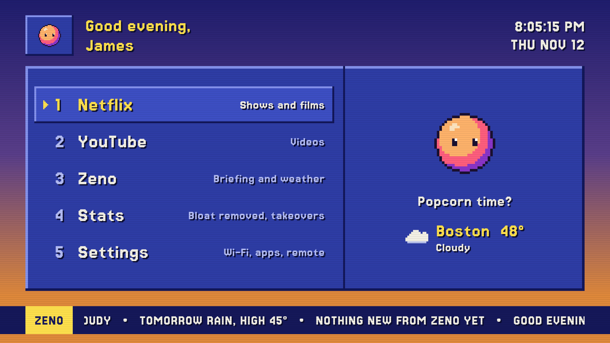
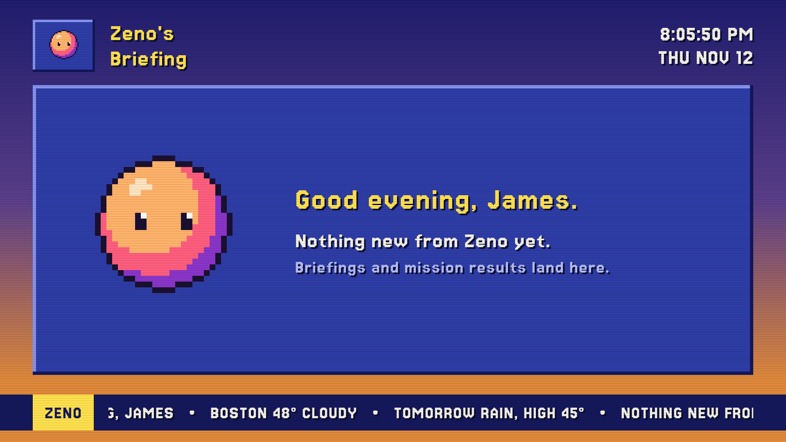
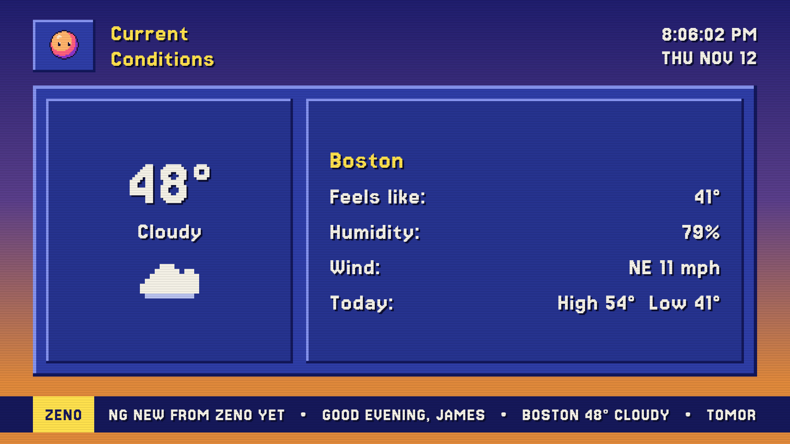
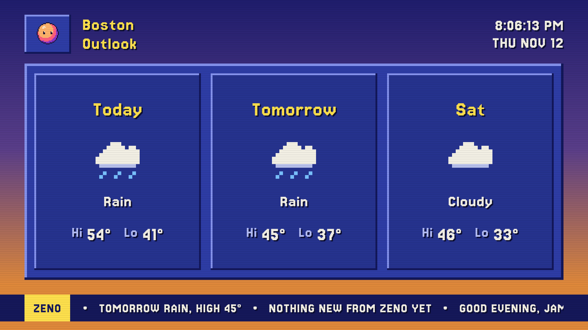
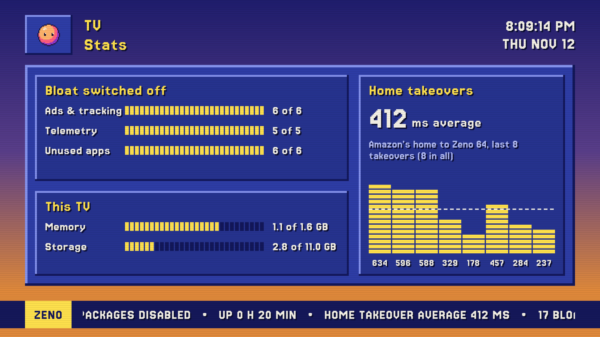

# Zeno 64

**My TV answers to my AI now.** A home screen and screensaver for my Insignia Fire TV, styled like a 90s weather
channel, with Zeno, my AI agent, as the station mascot. Amazon's ad-filled home screen never shows, the ads and
tracking are switched off, and every change can be undone.



Write-up: [jamescronin.dev/projects/zeno-64](https://www.jamescronin.dev/projects/zeno-64)

## What it does

- **Home:** a channel guide (Netflix, YouTube, Zeno, Stats, Settings). Up and down on the remote to move, OK to
  open. Zeno glances at whatever you land on.
- **Zeno's channel:** replaces Amazon's ad screensaver. Cuts between Zeno's briefing, current conditions, a
  three-day outlook and TV stats every 10 seconds.
- **Stats:** bloat switched off, memory and storage, and how long each Home press takes to hand over to Zeno 64.
- **Settings:** opens the TV's own settings screens directly: Network, Applications, Remotes & Bluetooth,
  Device & Software, Accessibility.
- **Debloat:** 17 ad, tracking, telemetry and unused preinstalled packages switched off with `pm disable-user`.
  Nothing is uninstalled.

| | |
|---|---|
|  |  |
|  |  |

Every screenshot is a straight `screencap` from the TV.

## Taking over Home on Fire OS

Fire OS sends the Home button to Amazon's launcher by name and marks the launcher as a protected package, so
without root it can't be disabled, and Android's own `set-home-activity` is ignored. Zeno 64 works around it:

1. An accessibility service ([`HomeWatcher.kt`](app/src/main/java/dev/jamescronin/zeno64/HomeWatcher.kt)) listens
   only for "a new screen opened" events. It can't read what's on screen.
2. When Amazon's home appears, it draws a full-screen Zeno cover as an accessibility overlay, which shows within a
   frame or two.
3. It opens Zeno 64 through an `AlarmManager` alarm set for right now. Android holds normal launches back for about
   5 seconds after Home is pressed; launches from an alarm come from the system and aren't held.
   `alarm_manager_constants min_futurity=0` removes the alarm's own 5-second minimum.
4. Media audio is muted until Zeno 64 is on screen, in case Amazon's home autoplays anything. It never unmutes a
   mute it didn't set.
5. At power-on the watcher opens Zeno 64 as soon as it connects. If it ever bounces more than 4 times in 15 seconds,
   it backs off for a minute and lets Amazon's home through.

Measured on my TV: no frames of Amazon's home in a frame-by-frame screen recording, and 0.2 to 0.6 seconds from
pressing Home to Zeno 64.

## Install

You need the Android SDK (Android Studio installs it; set `ANDROID_HOME` or add `sdk.dir` to `local.properties`),
JDK 17 or newer (Android Studio's bundled one works), adb, and ADB debugging turned on in the TV's Developer options.

```bash
./gradlew assembleDebug
adb connect <tv-ip>:5555
adb -s <tv-ip>:5555 install -r app/build/outputs/apk/debug/app-debug.apk
tools/apply-zeno64.sh <tv-ip>:5555
```

`apply-zeno64.sh` turns on the Home watcher and Zeno's screensaver, removes the alarm delay, and switches off the
packages in [`debloat-packages.txt`](app/src/main/assets/debloat-packages.txt). Read that list before you run it.

### Undo

```bash
tools/restore-amazon.sh <tv-ip>:5555
adb -s <tv-ip>:5555 uninstall dev.jamescronin.zeno64
```

`restore-amazon.sh` puts back the settings my TV shipped with (Fire OS 7.7.1.7) and switches every debloated package
back on. On another model, check your stock screensaver first with
`adb shell settings get secure screensaver_components` and edit the script if it differs.

## Limits

- Built and tested on one TV: Insignia NS-43F301NA22 on Fire OS 7.7.1.7. Other models and versions may behave
  differently.
- Amazon refuses to disable some packages: the launcher, `ftvads.deeplinking`, `device.metrics`, `device.logmanager`
  and `crashmanager`.
- Display & Sounds and Preferences only open for Amazon-signed apps, so picture and sound stay on the remote's
  settings button.
- A Fire OS update can switch accessibility services off. Run `apply-zeno64.sh` again if Home goes back to Amazon.
- Not built yet: Zeno, on his Raspberry Pi, sending briefings to the TV; Zeno seeing and driving the TV; switching
  HDMI inputs.

## Layout

```
app/src/main/java/dev/jamescronin/zeno64/
  HomeScreen.kt        the channel guide
  ZenoChannel.kt       Zeno's channel pages
  ZenoDream.kt         the screensaver service that shows them
  HomeWatcher.kt       the Home takeover
  SettingsScreen.kt    the settings menu
  Stats.kt             the stats page and its pixel charts
  Weather.kt           Open-Meteo weather and 12x12 pixel icons
  Theme.kt, Broadcast.kt, ZenoSprite.kt   the look: colours, type, bevels, header, ticker, Zeno
tools/                 apply, restore and debloat scripts; zeno_sprite.py draws Zeno pixel by pixel
DESIGN.md              the design system
```

## Credits

- Inspired by people on TikTok hacking their TVs, and by [The Weather Channel's retro mode](https://weather.com/retro/),
  which I saw on X. Not affiliated with Amazon, Insignia or The Weather Channel.
- Weather data by [Open-Meteo.com](https://open-meteo.com/) (CC BY 4.0).
- Font: [Jersey 15](https://github.com/scfried/soft-type-jersey) by The Soft Type Project, under the SIL Open Font
  License 1.1 ([licenses/Jersey15-OFL.txt](licenses/Jersey15-OFL.txt)).
- Built with Claude Code.

## License

MIT, see [LICENSE](LICENSE). The Jersey 15 font keeps its own license, the SIL Open Font License 1.1.
